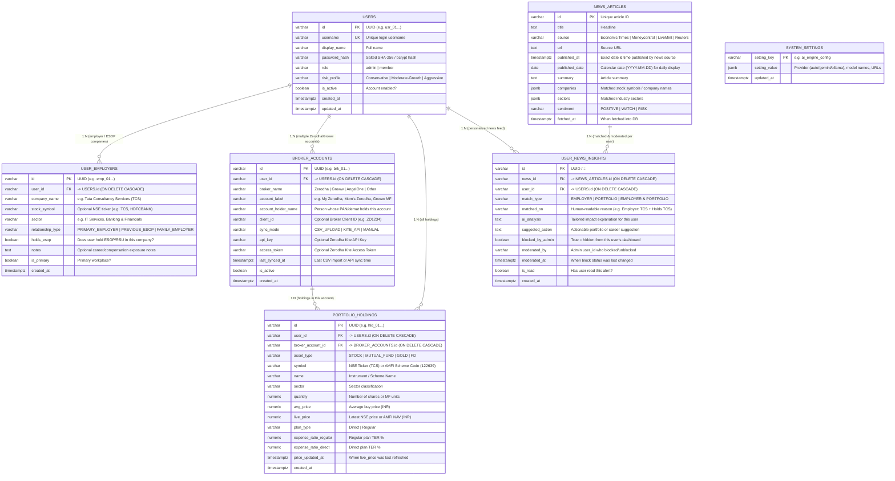

# WealthManager — Normalized Relational Database Schema

- **Product:** `wealth-manager` (`akkiverse/wealth-manager`)
- **Card:** https://github.com/akkiverse/product-think-tank/issues/5
- **Database Engine:** PostgreSQL (`Neon Serverless Postgres` on Vercel via `DATABASE_URL`) with SQLite local development parity (`data/wealth_manager.db`)
- **Suggested Vercel Database Name:** `wealth-manager-db`

---

## 1. Design Principles (Why Normalized Tables?)

1. **Clean `users` Table (Identity Only):** The `users` table stores only login credentials, role (`admin` vs `member`), and risk profile — no broker tokens or employer fields are crammed into `users`.
2. **Multiple Broker Accounts per User (`broker_accounts` mapped via `user_id`):**
   - A single logged-in user can link **multiple Zerodha accounts, multiple Groww accounts, or a family member's / HUF account they manage** (e.g., *"Abhishek — Personal Zerodha"*, *"Mom's Zerodha Account"*, *"Abhishek — Groww Mutual Funds"*).
   - Each broker account holds its own `account_holder_name`, `broker_name`, `client_id`, `api_key`, `access_token`, and `sync_mode`.
3. **Multiple Employer / Career Profiles per User (`user_employers` mapped via `user_id`):**
   - A user can track their **current employer**, a **previous employer where they still hold ESOPs/RSUs**, or a **spouse's employer** so news affecting any of those companies is matched accurately.
4. **Holdings Linked to Both `user_id` and `broker_account_id` (`portfolio_holdings`):**
   - Every stock, mutual fund, gold bond, or FD holding points to the exact `broker_account_id` it came from, enabling filtering by **"All Accounts"** or **"Specific Broker Account"** (e.g. only *Mom's Zerodha*).
5. **Daily News with Explicit Publication Dates (`news_articles` & `user_news_insights`):**
   - Every news article stores `published_at` (full timestamp) and `published_date` (`YYYY-MM-DD`) so the UI and Admin Matrix always show **when** the news was published and can filter by *Today / Yesterday / Date*.

---

## 2. Entity-Relationship (ER) Diagram



---

## 3. Exact SQL DDL (PostgreSQL & SQLite Compatible)

```sql
-- 1. Core Users (Identity & Login Only)
CREATE TABLE IF NOT EXISTS users (
    id VARCHAR(64) PRIMARY KEY,
    username VARCHAR(64) UNIQUE NOT NULL,
    display_name VARCHAR(120) NOT NULL,
    password_hash VARCHAR(256) NOT NULL,
    role VARCHAR(20) NOT NULL DEFAULT 'member',
    risk_profile VARCHAR(40) NOT NULL DEFAULT 'Moderate-Growth',
    is_active BOOLEAN NOT NULL DEFAULT TRUE,
    created_at TIMESTAMP WITH TIME ZONE DEFAULT CURRENT_TIMESTAMP,
    updated_at TIMESTAMP WITH TIME ZONE DEFAULT CURRENT_TIMESTAMP
);

-- 2. User Employers / Career Affiliations (1 User -> Many Companies)
CREATE TABLE IF NOT EXISTS user_employers (
    id VARCHAR(64) PRIMARY KEY,
    user_id VARCHAR(64) NOT NULL REFERENCES users(id) ON DELETE CASCADE,
    company_name VARCHAR(160) NOT NULL,
    stock_symbol VARCHAR(32) DEFAULT '',
    sector VARCHAR(100) NOT NULL,
    relationship_type VARCHAR(40) NOT NULL DEFAULT 'PRIMARY_EMPLOYER',
    holds_esop BOOLEAN NOT NULL DEFAULT FALSE,
    notes TEXT DEFAULT '',
    is_primary BOOLEAN NOT NULL DEFAULT TRUE,
    created_at TIMESTAMP WITH TIME ZONE DEFAULT CURRENT_TIMESTAMP
);
CREATE INDEX IF NOT EXISTS idx_user_employers_user_id ON user_employers(user_id);

-- 3. Broker Accounts (1 User -> Many Zerodha / Groww / Family Accounts)
CREATE TABLE IF NOT EXISTS broker_accounts (
    id VARCHAR(64) PRIMARY KEY,
    user_id VARCHAR(64) NOT NULL REFERENCES users(id) ON DELETE CASCADE,
    broker_name VARCHAR(40) NOT NULL,
    account_label VARCHAR(120) NOT NULL,
    account_holder_name VARCHAR(120) NOT NULL,
    client_id VARCHAR(64) DEFAULT '',
    sync_mode VARCHAR(32) NOT NULL DEFAULT 'CSV_UPLOAD',
    api_key VARCHAR(256) DEFAULT '',
    access_token VARCHAR(512) DEFAULT '',
    last_synced_at TIMESTAMP WITH TIME ZONE,
    is_active BOOLEAN NOT NULL DEFAULT TRUE,
    created_at TIMESTAMP WITH TIME ZONE DEFAULT CURRENT_TIMESTAMP
);
CREATE INDEX IF NOT EXISTS idx_broker_accounts_user_id ON broker_accounts(user_id);

-- 4. Portfolio Holdings (Mapped to both user_id and broker_account_id)
CREATE TABLE IF NOT EXISTS portfolio_holdings (
    id VARCHAR(64) PRIMARY KEY,
    user_id VARCHAR(64) NOT NULL REFERENCES users(id) ON DELETE CASCADE,
    broker_account_id VARCHAR(64) NOT NULL REFERENCES broker_accounts(id) ON DELETE CASCADE,
    asset_type VARCHAR(32) NOT NULL DEFAULT 'STOCK',
    symbol VARCHAR(64) NOT NULL,
    name VARCHAR(200) NOT NULL,
    sector VARCHAR(100) NOT NULL,
    quantity NUMERIC(18, 4) NOT NULL,
    avg_price NUMERIC(18, 4) NOT NULL,
    live_price NUMERIC(18, 4) NOT NULL,
    plan_type VARCHAR(20) NOT NULL DEFAULT 'Direct',
    expense_ratio_regular NUMERIC(6, 2) DEFAULT 0.0,
    expense_ratio_direct NUMERIC(6, 2) DEFAULT 0.0,
    price_updated_at TIMESTAMP WITH TIME ZONE DEFAULT CURRENT_TIMESTAMP,
    created_at TIMESTAMP WITH TIME ZONE DEFAULT CURRENT_TIMESTAMP
);
CREATE INDEX IF NOT EXISTS idx_holdings_user_id ON portfolio_holdings(user_id);
CREATE INDEX IF NOT EXISTS idx_holdings_broker_account_id ON portfolio_holdings(broker_account_id);

-- 5. News Articles (With Explicit Published Date & Timestamp)
CREATE TABLE IF NOT EXISTS news_articles (
    id VARCHAR(64) PRIMARY KEY,
    title TEXT NOT NULL,
    source VARCHAR(120) NOT NULL,
    url TEXT NOT NULL,
    published_at TIMESTAMP WITH TIME ZONE NOT NULL,
    published_date DATE NOT NULL,
    summary TEXT NOT NULL,
    companies_json TEXT NOT NULL DEFAULT '[]',
    sectors_json TEXT NOT NULL DEFAULT '[]',
    sentiment VARCHAR(20) NOT NULL DEFAULT 'WATCH',
    fetched_at TIMESTAMP WITH TIME ZONE DEFAULT CURRENT_TIMESTAMP
);
CREATE INDEX IF NOT EXISTS idx_news_published_date ON news_articles(published_date DESC);

-- 6. User News Insights & Admin Moderation Gatekeeper
CREATE TABLE IF NOT EXISTS user_news_insights (
    id VARCHAR(140) PRIMARY KEY,
    news_id VARCHAR(64) NOT NULL REFERENCES news_articles(id) ON DELETE CASCADE,
    user_id VARCHAR(64) NOT NULL REFERENCES users(id) ON DELETE CASCADE,
    match_type VARCHAR(40) NOT NULL,
    matched_on TEXT NOT NULL,
    ai_analysis TEXT NOT NULL,
    suggested_action TEXT NOT NULL,
    blocked_by_admin BOOLEAN NOT NULL DEFAULT FALSE,
    moderated_by VARCHAR(64) DEFAULT '',
    moderated_at TIMESTAMP WITH TIME ZONE,
    is_read BOOLEAN NOT NULL DEFAULT FALSE,
    created_at TIMESTAMP WITH TIME ZONE DEFAULT CURRENT_TIMESTAMP,
    UNIQUE(news_id, user_id)
);
CREATE INDEX IF NOT EXISTS idx_user_news_user_id ON user_news_insights(user_id);

-- 7. System Settings (AI Provider Config: Gemini / Ollama)
CREATE TABLE IF NOT EXISTS system_settings (
    setting_key VARCHAR(64) PRIMARY KEY,
    setting_value_json TEXT NOT NULL,
    updated_at TIMESTAMP WITH TIME ZONE DEFAULT CURRENT_TIMESTAMP
);
```
